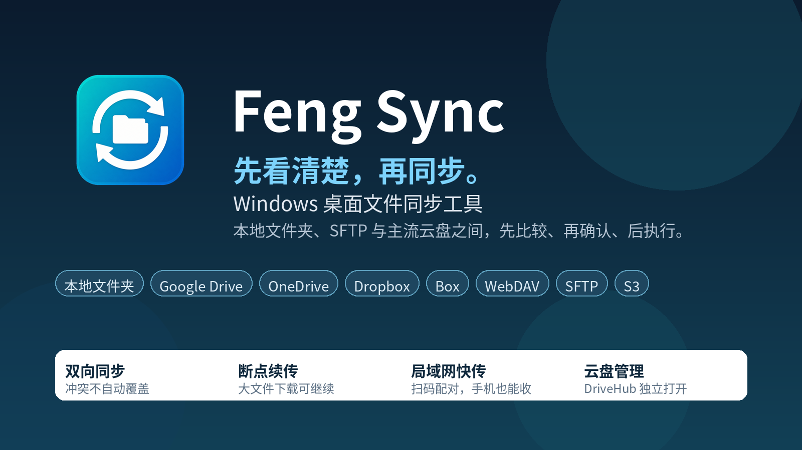
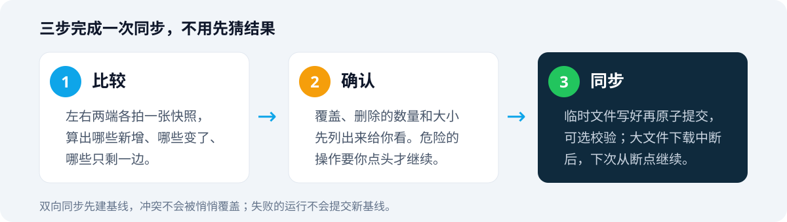
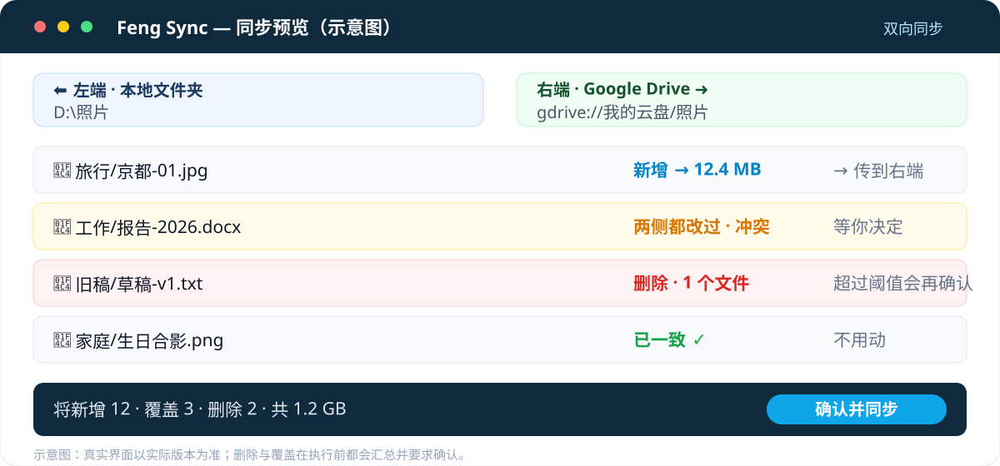

# Feng Sync

> Windows 桌面文件同步工具。本地文件夹、SFTP 与主流云盘之间，先比较、再确认、后执行。

[](LICENSE)
[](#安装)
[](https://github.com/zoollcar/feng-sync/releases)



文件放在电脑、NAS、Google Drive、OneDrive 和 S3 里，同步出错的代价往往比同步慢更大。一边删了文件，另一边跟着删。两边都改过，新的盖掉旧的，等发现时已经晚了。

Feng Sync 把两边摊开给你看，哪些要新增、哪些要覆盖、哪些要删除、冲突在哪里，列清楚之后再动手。拿不准的地方，它会停下来等你决定。

## 界面一览

<table>
<tr>
<td></td>
<td><strong>同步主界面</strong><br /><br />左侧是本地文件夹，右侧是 <code>gdrive://Google\_Drive/cloud</code>，双向同步。中间是比较结果，右侧汇总本次变更，上传 23 项 208.0 MB，下载 0 项，删除 1 项，冲突 0 项，共 26 项。</td>
</tr>
<tr>
<td></td>
<td><strong>云盘管理</strong><br /><br />左侧是云盘端点列表，包括 S3 Bucket R2 和 Google Drive。右侧是文件浏览器，可以上传文件、上传文件夹、搜索、排序和收藏目录。顶部的另一个页签是挂载管理。</td>
</tr>
<tr>
<td></td>
<td><strong>局域网快传</strong><br /><br />左侧是群聊，右侧是配对二维码和 6 位配对码。顶部是本机名、自动接收开关、接收目录和端口 59871。截图里的配对码已经过期，不能再用。</td>
</tr>
</table>

## 30 秒上手

1. 去 [Releases](https://github.com/zoollcar/feng-sync/releases) 下载最新版 `FengSync-<版本>-win-x64.zip`，解压后双击 `FengSync.exe`。
2. 左右两边各填一个位置。本地文件夹直接填路径，云端填 `sftp://`、`gdrive://`、`onedrive://`、`dropbox://`、`box://`、`webdav://`、`s3://` 这样的地址。
3. 点**比较**，看一眼预览，点**同步**。

rclone 已随程序附带，不用另外安装或写配置文件。云盘授权在浏览器里点几下就完成。



## 它能帮你做什么

| 场景                       | Feng Sync 的做法                                                                                                                       |
| -------------------------- | -------------------------------------------------------------------------------------------------------------------------------------- |
| **电脑与云盘之间**         | 本地文件夹与 Google Drive、OneDrive、Dropbox、Box、WebDAV、S3、SFTP 之间双向同步。第一次同步会建基线，之后才能可靠判断删除和双侧修改。 |
| **两台电脑或两个云盘之间** | 同一套比较和确认流程，云盘之间也可以直接同步，不必先下载到本地再上传。                                                                 |
| **照片和文档定期备份**     | 建一个 Profile，设好包含和排除规则，之后一键运行，或交给 Windows 计划任务定时跑。                                                      |
| **大文件传一半断了**       | 下载大文件默认 500 MB 以上支持断点续传，下次从断点继续，不用从头再来。                                                                 |
| **只想管云盘，不想同步**   | 发行包里还有独立的 `DriveHub.exe`，双击只打开云盘管理，上传、下载、拖放、看进度、取消都可以。                                          |
| **同一局域网传文件**       | 打开局域网快传，手机扫码配对就能收发，像群聊一样发文件。陌生设备的第一次写入要你点「同意」才会落盘。                                   |
| **把云盘当成本地盘用**     | 可以把 Google Drive、SFTP、S3 挂载为 Windows 盘符或目录，直接在资源管理器里打开。                                                      |
| **家里或办公室搭个 SFTP**  | 内置 SFTP 服务器，在界面里配好地址、端口和账号就能用，不用另外装服务端。                                                               |

## 同步之前，先确认同步内容



- 每一项操作都列出来，新增、覆盖、删除各有多少，总共多大，执行前一次看清。
- 删除数量或比例超过阈值时，会要求再次确认。删掉的文件可以进回收站，或移入带时间戳的归档目录。
- 两边都改过的文件会停下来等你决定，不会用新文件盖掉旧文件。
- 先写临时文件再原子提交，可选复制后校验。执行前还会再检查源文件有没有在比较之后变过，避免按过期计划传输。
- Profile 里不存远程密码、私钥或 OAuth 信息。远程连接由 rclone 配置管理，凭据不会写进 CLI 参数或运行日志。

断点续传目前只支持从远程下载。上传到远程中断后需要整体重传，远程到远程的复制也一样，原因是底层 rclone 接口没有提供按偏移写入。

## 云盘管理

云盘管理是 Feng Sync 里单独的一块，用来直接操作云端文件，不走同步流程。

主程序左侧边栏有「云盘管理」入口，发行包里还有独立的 `DriveHub.exe`，双击只打开云盘管理窗口。两者共用同一份云端端点配置，各自运行独立的 rclone 守护进程和传输队列，可以单独用，也可以和主程序同时运行。

在云盘管理里可以做这些事。

- 浏览 Google Drive、OneDrive、Dropbox、Box、WebDAV、S3、SFTP 里的文件和文件夹，支持列表和网格两种视图。
- 把本地文件或文件夹拖进窗口上传，把云端文件拖出窗口下载。上传和下载都显示进度，可以中途取消。
- 复制、剪切、粘贴、重命名、删除、查看属性。删除默认进应用自己的回收站目录 `.fengsync-trash`，可以再还原或清空。
- 同名文件上传时可以选择覆盖、保留两者或跳过，也可以一次应用到整个批次。
- 图片支持缩略图和预览，文本文件支持预览。文件夹可以统计云端大小。
- 收藏常用目录，最近访问的目录会另外记一份，两份列表的规则不一样，收藏不会被最近访问顶掉。
- 端点可以分组、改名、导出和导入。导出只含端点名、类型和路径信息，不含凭据。

云盘管理和主程序的同步共用同一套传输机制，上传下载中断后，大文件下载可以从断点继续。

## 局域网快传

局域网快传用来在同一局域网里传文件，不经过云，也不用装 App。窗口打开时服务才运行，窗口关闭，服务就停了。

用法分四步。

1. 在主程序打开局域网快传窗口，顶栏填好这台电脑的名字、接收目录和端口，默认端口是 59871。
2. 另一台电脑或手机扫右侧的二维码，或打开二维码下方的网址。配对码是 6 位数字，单次使用，120 秒过期。
3. 配对成功后，对方出现在群聊里。发文件时点「发文件」或「发文件夹」，也可以直接把文件拖进窗口。
4. 发出去的只是一条「本机有这个文件」的消息，谁要谁在那一条下面点「接收」，进度和落地位置都显示在那一条上。

还有几条使用时需要注意的地方。

- 陌生设备直接推过来的文件会列在窗口顶部，需要你点「同意」才会落盘。成为受信设备后，默认自动接收，这个开关可以在窗口里关掉。
- 自动接收开关同时管两条路，别人推过来的文件，和群里说过、由本机自己去取的文件。
- 群记录只存在内存里，窗口关闭就消失，磁盘上没有一份群历史。
- 传输走明文 HTTP，只在局域网内使用。配对令牌只存在当前用户的 DPAPI 凭据文件里，不进二维码、日志、命令行或配置文件。
- 第一次使用时，窗口提供一键放行防火墙的按钮，规则按端口放行，TCP 与 UDP 各一条。重复点击不会重复建规则，但可能再出现一次 UAC 弹窗。
- 手机用浏览器打开配对网址就能收发，页面和桌面窗口是同一个群聊。

## 挂载为磁盘

挂载可以把远程端点变成 Windows 里能直接打开的盘，别的程序也能直接读写云上的文件。

入口在云盘管理的「挂载管理」页签，也可以从主程序工具菜单里的「远程端点管理」窗口打开。支持 Google Drive、SFTP、S3，挂载为盘符或目录。

使用时有几条规则。

- 创建挂载前会检查 WinFsp，没有装会明确提示，先装 [WinFsp](https://winfsp.dev/) 再挂载。
- 挂载列表会扫描系统里全部 rclone mount 进程，显示实时状态。
- 正常退出时，Feng Sync 会自动停止自己创建的挂载。异常退出后，残留挂载仍能被扫描出来，在列表里手动卸载。
- 主程序和 DriveHub 各自管理自己创建的挂载，互不干扰。

## 内置 SFTP 服务器

内置 SFTP 服务器用来让另一台电脑连到这台电脑上同步或取文件，适合家里或办公室的局域网。

在主程序的设置里打开 SFTP 服务器配置，可以设置监听地址、端口、一个共享根目录和一个密码账号，支持启动、停止和诊断。服务器由随应用分发的 rclone 提供，不依赖 Node.js 或 npm 模块。

使用时注意两点。只监听受信任的网络地址，每个服务实例只暴露一个可读写共享根目录和一个密码账号。

## 和同类工具怎么选

没有一个工具适合所有人，选错类型比选错品牌更浪费时间。

|                      | **Feng Sync**                                          | **Syncthing**                        | **FreeFileSync**                   | **rclone（命令行）**                   | **云盘官方客户端**           |
| -------------------- | ------------------------------------------------------ | ------------------------------------ | ---------------------------------- | -------------------------------------- | ---------------------------- |
| **最适合**           | Windows 上，先看预览再同步本地与多个云盘               | 多台设备之间持续、自动同步，不经过云 | 本地文件夹之间可视化比较、手动同步 | 脚本、服务器、批量处理，什么后端都能接 | 只用某一家云盘，装好就不管了 |
| **同步方式**         | 手动或定时任务，按 Profile 运行                        | 持续实时，双向自动                   | 手动或定时，比较后执行             | 命令行，随你编排                       | 持续实时，单家云盘           |
| **看得到要改什么吗** | 比较预览加执行前确认                                   | 持续同步，一般不逐项确认             | 可视化比较                         | 有 `--dry-run`，但要看命令行输出       | 通常不同步前逐项确认         |
| **云盘支持**         | Google Drive、OneDrive、Dropbox、Box、WebDAV、S3、SFTP | 不接云盘，只同步你自己的设备         | 以本地为主，部分云盘支持           | 70 多种后端，最全                      | 只接自家一家                 |
| **上手难度**         | 低，图形界面，点几下就好                               | 中，要配设备、理解去中心化同步       | 低，图形界面                       | 高，要会命令行                         | 最低，装好登录就行           |
| **平台**             | Windows                                                | Windows、macOS、Linux、Android       | Windows、macOS、Linux              | 全平台                                 | 全平台                       |

怎么选可以按这几条对照。

- 想要同步前先看一眼，云盘换着用，在 Windows 上一站式搞定，选 Feng Sync。
- 想要几台自己的设备永远保持一致，不走任何云，选 Syncthing。
- 只要两个本地文件夹比一比、同步一下，FreeFileSync 更轻。
- 习惯写脚本、在服务器上跑，直接用 rclone。Feng Sync 底层用的也是它。

## 适合你吗

**适合**

- 在 Windows 上工作，文件分布在本地、NAS 和几个云盘里
- 同步前想先看清楚，删文件、覆盖文件时想多一道确认
- 想要一个工具同时管同步、云盘、局域网快传和挂载

**不太适合**

- 不用 Windows，目前只有 Windows 桌面版
- 想要手机 App 或 macOS、Linux 版
- 想要全天候实时同步，改一个文件立刻自动同步到所有设备。Feng Sync 是按需或定时同步。

## 安装

**普通用户，下载即用**

去 [Releases](https://github.com/zoollcar/feng-sync/releases) 下载最新版 zip，解压后运行 `FengSync.exe`。挂载功能需要先装 [WinFsp](https://winfsp.dev/)，没有装时程序会明确提示。

**开发者，从源码构建**

需要 .NET 10 SDK 和 Node.js 22。Node 只在构建时用，运行时不需要。

```powershell
dotnet run --project src/FengSync
```

<details>
<summary>命令行、测试与更多细节</summary>

构建后可以用 Profile ID 或导出的 Profile JSON 执行比较和同步。

```powershell
dotnet build FengSync.sln

.\src\FengSync.Cli\bin\Debug\net10.0\FengSync.Cli.exe compare --profile <profile-id>
.\src\FengSync.Cli\bin\Debug\net10.0\FengSync.Cli.exe run --profile <profile-id> --non-interactive --json-log
```

测试分三级，默认跑在私有桌面上，不抢鼠标、不抢前台。

```powershell
# 核心、CLI、真实 SFTP，不启动 WPF UI
pwsh -File .\scripts\Test-All.ps1 -Level Core

# 上一级加本地与 SFTP 的 WPF UI，不访问线上服务商
pwsh -File .\scripts\Test-All.ps1 -Level UiOffline

# 再加线上服务 UI 测试
pwsh -File .\scripts\Test-All.ps1 -Level Online
```

应用数据默认保存在用户本地应用数据目录，也可以用 `FENGSYNC_DATA_DIR` 指定隔离的数据目录。更多实现细节见仓库里的 [AGENTS.md](AGENTS.md)。

</details>

## 参与贡献

欢迎提 Issue、修 bug、补文档、加翻译。

## License

MIT，详见 [LICENSE](LICENSE)。底层同步能力基于 [rclone](https://github.com/rclone/rclone)，第三方声明见 [THIRD\_PARTY\_NOTICES.md](THIRD_PARTY_NOTICES.md)。